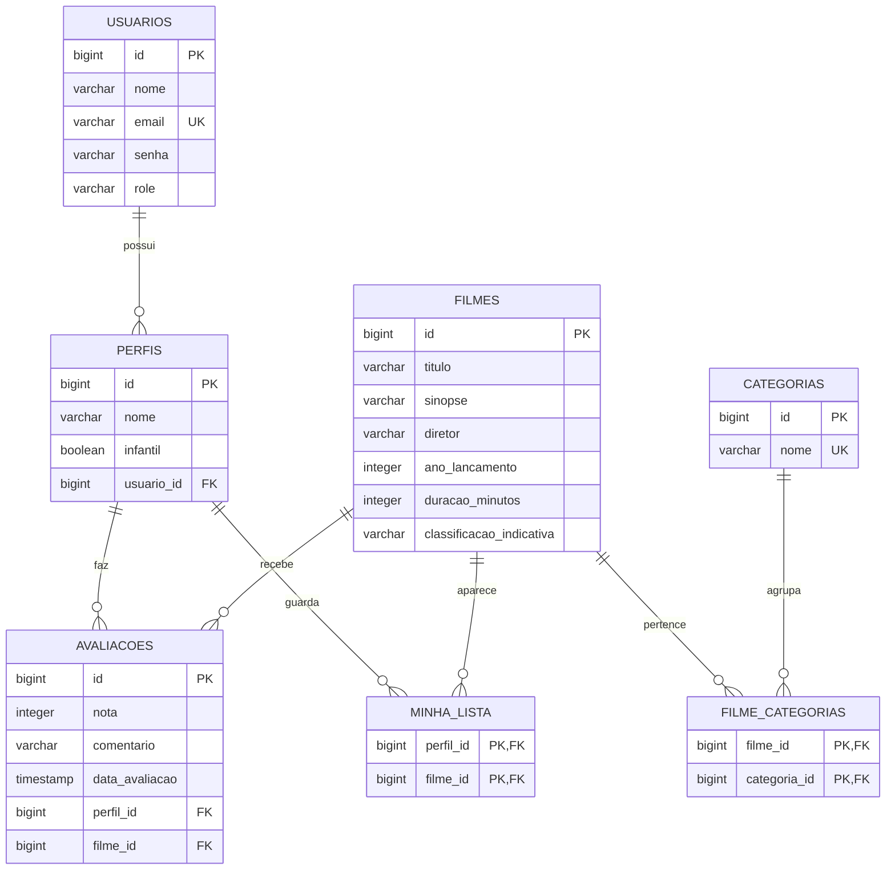

# springFlix

API REST de streaming de filmes inspirada na Netflix. Usuários criam perfis, montam a sua "minha lista" e avaliam filmes de um catálogo organizado por categorias. O acesso é protegido com JWT e controlado por papel (ADMIN e USER).

Projeto do Trabalho 1 de Desenvolvimento Backend com Spring Boot.

## Tecnologias

- Java 25 e Spring Boot 4.1 (Web MVC, Data JPA, Validation, Security)
- JWT com `com.auth0:java-jwt`
- PostgreSQL 17 e Flyway
- Lombok
- Swagger/OpenAPI com springdoc
- Docker Compose

## Como rodar

O Flyway cria as tabelas e carrega os dados de exemplo na primeira execução: 2 usuários, 13 categorias, 30 filmes reais, 3 perfis (Admin, Ana e Kids), itens de "minha lista" e 7 avaliações.

### Opção 1: Docker (recomendado)

Só precisa do Docker instalado:

```bash
docker compose up --build
```

- Frontend: http://localhost:8080
- Swagger: http://localhost:8080/swagger-ui.html

### Opção 2: pela IDE ou pelo terminal (JDK 25)

Suba só o banco e rode a aplicação:

```bash
docker compose up -d postgres
./gradlew bootRun
```

No Windows, use `gradlew.bat bootRun`. O banco fica exposto na porta **5433** do host para não conflitar com um PostgreSQL local.

Para apagar o banco e recomeçar do zero: `docker compose down -v`.

## Credenciais

| Tipo | E-mail | Senha |
|------|--------|-------|
| ADMIN | admin@springflix.com | admin123 |
| USER | usuario@springflix.com | usuario123 |

| Banco | Valor |
|-------|-------|
| Host / porta | localhost:5433 |
| Database | app |
| Usuário / senha | postgres / postgres |

A chave do JWT pode ser trocada pela variável de ambiente `JWT_SECRET`. O token expira em 2 horas.

## Autenticação

1. Faça login em `POST /auth/login` e copie o `token` da resposta.
2. Envie o token nas demais requisições: `Authorization: Bearer <token>`.
3. No Swagger, clique em **Authorize** e cole o token.

| Situação | Status |
|----------|--------|
| Sem token, token inválido ou expirado | 401 |
| Usuário sem permissão (ex.: USER criando filme) | 403 |

## Estrutura de pastas

O código é dividido em módulos por funcionalidade (`filmes`, `categorias`, `perfis`, `avaliacoes`, `usuarios` e `auth`). Dentro de cada módulo há uma pasta por camada: `controller`, `service`, `repository`, `entity` e `dto`. O que é compartilhado entre os módulos fica em `core`.

### Camadas

Uma requisição sempre passa pelas camadas na mesma ordem: **Controller → Service → Repository → banco**. A resposta volta como DTO de saída.

| Pasta | Responsabilidade | Anotações principais | Exemplo |
|-------|------------------|----------------------|---------|
| `controller` | Recebe a requisição HTTP, valida o DTO de entrada e devolve o DTO de saída. Não tem regra de negócio. | `@RestController`, `@RequestMapping`, `@GetMapping`, `@PostMapping`, `@Valid` | `FilmeController` |
| `service` | Regras de negócio, transações e logs. Converte DTO em entidade e entidade em DTO. | `@Service`, `@Transactional`, `@Slf4j` | `FilmeService` |
| `repository` | Acesso ao banco com Spring Data JPA. As consultas são geradas pelo nome do método (ex.: `findByTituloContainingIgnoreCase`). | interface que estende `JpaRepository` | `FilmeRepository` |
| `entity` | Classes mapeadas para as tabelas do banco e os relacionamentos entre elas. | `@Entity`, `@Table`, `@ManyToOne`, `@ManyToMany` | `Filme` |
| `dto` | Dados que entram (`Request`, com validações) e que saem (`Response`) da API. A entidade nunca é exposta diretamente. | `record`, `@NotBlank`, `@Email`, `@Size`, `@Min`, `@Max`, `@Pattern` | `FilmeRequest`, `FilmeResponse` |

| Pasta do `core` | Responsabilidade |
|-----------------|------------------|
| `core/exception` | Exceções da aplicação e o `GlobalExceptionHandler` (`@RestControllerAdvice`), que transforma erros em JSON com status 400, 401 ou 404 |
| `core/security` | `SecurityConfig` (rotas públicas, autenticadas e só ADMIN), `SecurityFilter` (lê o JWT de cada requisição) e `TokenService` (gera e valida o token) |
| `core/config` | `OpenApiConfig`, configuração do Swagger com o botão Authorize |

### Árvore completa

```
src/main/java/com/spring/flix
├── SpringFlixApplication.java
├── auth                                 login e cadastro público
│   ├── controller/AuthController.java
│   ├── service/AuthService.java
│   └── dto/LoginRequest.java, RegistroRequest.java, TokenResponse.java
├── usuarios                             CRUD de usuários (ADMIN)
│   ├── controller/UsuarioController.java
│   ├── service/UsuarioService.java
│   ├── repository/UsuarioRepository.java
│   ├── entity/Usuario.java, Role.java
│   └── dto/UsuarioRequest.java, UsuarioResponse.java
├── perfis                               CRUD de perfis e "minha lista"
│   ├── controller/PerfilController.java
│   ├── service/PerfilService.java
│   ├── repository/PerfilRepository.java
│   ├── entity/Perfil.java
│   └── dto/PerfilRequest.java, PerfilResponse.java
├── filmes                               CRUD do catálogo de filmes
│   ├── controller/FilmeController.java
│   ├── service/FilmeService.java
│   ├── repository/FilmeRepository.java
│   ├── entity/Filme.java
│   └── dto/FilmeRequest.java, FilmeResponse.java
├── categorias                           CRUD de categorias
│   ├── controller/CategoriaController.java
│   ├── service/CategoriaService.java
│   ├── repository/CategoriaRepository.java
│   ├── entity/Categoria.java
│   └── dto/CategoriaRequest.java, CategoriaResponse.java
├── avaliacoes                           CRUD de avaliações
│   ├── controller/AvaliacaoController.java
│   ├── service/AvaliacaoService.java
│   ├── repository/AvaliacaoRepository.java
│   ├── entity/Avaliacao.java
│   └── dto/AvaliacaoRequest.java, AvaliacaoResponse.java
└── core
    ├── config/OpenApiConfig.java
    ├── exception/GlobalExceptionHandler.java, ErroResponse.java,
    │             RecursoNaoEncontradoException.java, RegraNegocioException.java
    └── security/SecurityConfig.java, SecurityFilter.java, TokenService.java

src/main/resources
├── application.yaml
├── db/migration
│   ├── V1__criar_tabelas.sql
│   └── V2__inserir_dados.sql
└── static                               frontend (index.html, css/style.css, js/app.js)
```

O módulo `auth` não tem `entity` nem `repository`, porque usa os de `usuarios`.

## Modelo de dados (DER)



Relacionamentos:

- **1:N**: Usuário → Perfis, Perfil → Avaliações, Filme → Avaliações
- **N:N**: Filme ↔ Categoria (`filme_categorias`) e Perfil ↔ Filme (`minha_lista`)

## Regras de negócio

| Entidade | Regras |
|----------|--------|
| Usuário | E-mail único. Senha salva com BCrypt. O cadastro público cria sempre um USER. Só o ADMIN gerencia usuários. |
| Perfil | Máximo de 5 perfis por usuário. Cada usuário só acessa os próprios perfis. Perfil infantil só adiciona à lista filmes com classificação L ou 10. |
| Filme | Precisa de ao menos uma categoria existente. Busca por título. Só o ADMIN cadastra, altera e exclui. |
| Categoria | Nome único. Não pode ser excluída se tiver filmes vinculados. |
| Avaliação | Nota de 1 a 5. Cada perfil avalia um filme uma única vez. Só o dono do perfil cria, altera ou exclui a avaliação. |

## Endpoints

| Método | Rota | Acesso | Descrição |
|--------|------|--------|-----------|
| POST | `/auth/registrar` | Público | Cadastra um usuário USER |
| POST | `/auth/login` | Público | Retorna o token JWT |
| GET | `/usuarios` | ADMIN | Lista os usuários |
| GET | `/usuarios/{id}` | ADMIN | Busca um usuário |
| POST | `/usuarios` | ADMIN | Cria um usuário informando o papel |
| PUT | `/usuarios/{id}` | ADMIN | Atualiza um usuário |
| DELETE | `/usuarios/{id}` | ADMIN | Exclui um usuário |
| GET | `/categorias` | Autenticado | Lista as categorias |
| GET | `/categorias/{id}` | Autenticado | Busca uma categoria |
| POST | `/categorias` | ADMIN | Cria uma categoria |
| PUT | `/categorias/{id}` | ADMIN | Atualiza uma categoria |
| DELETE | `/categorias/{id}` | ADMIN | Exclui uma categoria |
| GET | `/filmes?titulo=` | Autenticado | Lista os filmes (filtro opcional por título) |
| GET | `/filmes/{id}` | Autenticado | Busca um filme |
| POST | `/filmes` | ADMIN | Cria um filme |
| PUT | `/filmes/{id}` | ADMIN | Atualiza um filme |
| DELETE | `/filmes/{id}` | ADMIN | Exclui um filme |
| GET | `/perfis` | Autenticado | Lista os perfis do usuário logado |
| GET | `/perfis/{id}` | Dono | Busca um perfil |
| POST | `/perfis` | Autenticado | Cria um perfil para o usuário logado |
| PUT | `/perfis/{id}` | Dono | Atualiza um perfil |
| DELETE | `/perfis/{id}` | Dono | Exclui um perfil |
| GET | `/perfis/{id}/minha-lista` | Dono | Lista os filmes da "minha lista" |
| POST | `/perfis/{id}/minha-lista/{filmeId}` | Dono | Adiciona um filme à lista |
| DELETE | `/perfis/{id}/minha-lista/{filmeId}` | Dono | Remove um filme da lista |
| GET | `/avaliacoes?filmeId=` | Autenticado | Lista as avaliações (filtro opcional por filme) |
| GET | `/avaliacoes/{id}` | Autenticado | Busca uma avaliação |
| POST | `/avaliacoes` | Autenticado | Avalia um filme com um perfil próprio |
| PUT | `/avaliacoes/{id}` | Dono | Atualiza uma avaliação |
| DELETE | `/avaliacoes/{id}` | Dono | Exclui uma avaliação |

## Exemplos de requests e responses

Os exemplos usam os dados carregados pela migration V2. Com exceção do login e do cadastro, todas as requisições precisam do header `Authorization: Bearer <token>`.

### Login

`POST /auth/login`

```json
{
  "email": "admin@springflix.com",
  "senha": "admin123"
}
```

Resposta `200 OK`:

```json
{
  "token": "eyJhbGciOiJIUzI1NiIsInR5cCI6IkpXVCJ9...",
  "tipo": "Bearer"
}
```

### Cadastro público

`POST /auth/registrar`

```json
{
  "nome": "Maria Souza",
  "email": "maria@email.com",
  "senha": "maria123"
}
```

Resposta `201 Created`:

```json
{
  "id": 3,
  "nome": "Maria Souza",
  "email": "maria@email.com",
  "role": "USER"
}
```

### Buscar filmes por título

`GET /filmes?titulo=cidade`

Resposta `200 OK`:

```json
[
  {
    "id": 11,
    "titulo": "Cidade de Deus",
    "sinopse": "Buscapé cresce na Cidade de Deus, no Rio de Janeiro, entre os anos 1960 e 1980, e acompanha pela lente de sua câmera a escalada do tráfico e da violência que transforma a vida dos amigos de infância.",
    "diretor": "Fernando Meirelles e Kátia Lund",
    "anoLancamento": 2002,
    "duracaoMinutos": 130,
    "classificacaoIndicativa": "16",
    "categorias": [
      { "id": 5, "nome": "Crime" },
      { "id": 6, "nome": "Drama" },
      { "id": 10, "nome": "Nacional" }
    ]
  }
]
```

### Cadastrar filme (ADMIN)

`POST /filmes`

```json
{
  "titulo": "Bacurau",
  "sinopse": "Moradores de um povoado do sertão percebem que a cidade sumiu dos mapas e passam a enfrentar ameaças misteriosas.",
  "diretor": "Kleber Mendonça Filho e Juliano Dornelles",
  "anoLancamento": 2019,
  "duracaoMinutos": 131,
  "classificacaoIndicativa": "16",
  "categoriaIds": [6, 10, 12]
}
```

Resposta `201 Created`:

```json
{
  "id": 31,
  "titulo": "Bacurau",
  "sinopse": "Moradores de um povoado do sertão percebem que a cidade sumiu dos mapas e passam a enfrentar ameaças misteriosas.",
  "diretor": "Kleber Mendonça Filho e Juliano Dornelles",
  "anoLancamento": 2019,
  "duracaoMinutos": 131,
  "classificacaoIndicativa": "16",
  "categorias": [
    { "id": 6, "nome": "Drama" },
    { "id": 10, "nome": "Nacional" },
    { "id": 12, "nome": "Suspense" }
  ]
}
```

### Dados inválidos

`POST /filmes`

```json
{
  "titulo": "",
  "anoLancamento": 1500,
  "duracaoMinutos": 120,
  "classificacaoIndicativa": "20",
  "categoriaIds": []
}
```

Resposta `400 Bad Request`:

```json
{
  "timestamp": "2026-09-30T00:52:14.456145681",
  "status": 400,
  "mensagem": "Dados inválidos",
  "erros": [
    "anoLancamento: deve ser maior que ou igual à 1888",
    "categoriaIds: não deve estar vazio",
    "classificacaoIndicativa: deve ser L, 10, 12, 14, 16 ou 18",
    "diretor: não deve estar em branco",
    "sinopse: não deve estar em branco",
    "titulo: não deve estar em branco"
  ]
}
```

### USER tentando cadastrar filme

`POST /filmes` com o token do `usuario@springflix.com`

Resposta `403 Forbidden`:

```json
{
  "timestamp": "2026-09-30T00:52:14.482Z",
  "status": 403,
  "error": "Forbidden",
  "path": "/filmes"
}
```

### Criar perfil

`POST /perfis`

```json
{
  "nome": "Pedro",
  "infantil": false
}
```

Resposta `201 Created`:

```json
{
  "id": 4,
  "nome": "Pedro",
  "infantil": false
}
```

### Perfil infantil adicionando filme 18 anos à lista

`POST /perfis/3/minha-lista/7` (perfil "Kids", filme "Pulp Fiction: Tempo de Violência")

Resposta `400 Bad Request`:

```json
{
  "timestamp": "2026-09-30T00:52:14.56749246",
  "status": 400,
  "mensagem": "Perfil infantil só pode adicionar filmes com classificação L ou 10",
  "erros": []
}
```

### Avaliar filme

`POST /avaliacoes`

```json
{
  "perfilId": 2,
  "filmeId": 13,
  "nota": 5,
  "comentario": "Filme nacional de primeira."
}
```

Resposta `201 Created`:

```json
{
  "id": 8,
  "nota": 5,
  "comentario": "Filme nacional de primeira.",
  "dataAvaliacao": "2026-09-30T00:52:14.595554731",
  "perfilId": 2,
  "perfilNome": "Ana",
  "filmeId": 13,
  "filmeTitulo": "Tropa de Elite"
}
```

Avaliar o mesmo filme de novo com o mesmo perfil retorna `400` com a mensagem `"Este perfil já avaliou este filme"`.

## Tratamento de erros

Todos os erros tratados pelo `GlobalExceptionHandler` seguem o mesmo formato:

| Status | Quando |
|--------|--------|
| 400 | Dados inválidos, JSON malformado, parâmetro inválido ou regra de negócio violada |
| 401 | Não autenticado ou login inválido |
| 403 | Sem permissão para o recurso |
| 404 | Recurso não encontrado |

## Frontend

O frontend é feito em HTML, CSS e JavaScript puro, sem framework nem build. Os arquivos ficam em `src/main/resources/static` e o próprio Spring Boot serve as páginas junto com a API. Basta subir a aplicação e abrir **http://localhost:8080**.

| Tela | O que faz |
|------|-----------|
| Login / Criar conta | Autentica em `/auth/login` e guarda o token JWT no navegador |
| Quem está assistindo? | Lista, cria, edita e exclui os perfis do usuário |
| Início | Catálogo em fileiras por categoria, busca por título e filtro por categoria |
| Detalhes do filme | Sinopse, classificação, média das notas, "minha lista" e avaliações do perfil |
| Minha lista | Filmes salvos no perfil selecionado |
| Administração (só ADMIN) | CRUD de filmes, categorias e usuários |

As mensagens de erro da API aparecem na tela. Por exemplo: validação ao salvar filme sem dados, perfil infantil adicionando filme 18 anos ou exclusão de categoria com filmes.
